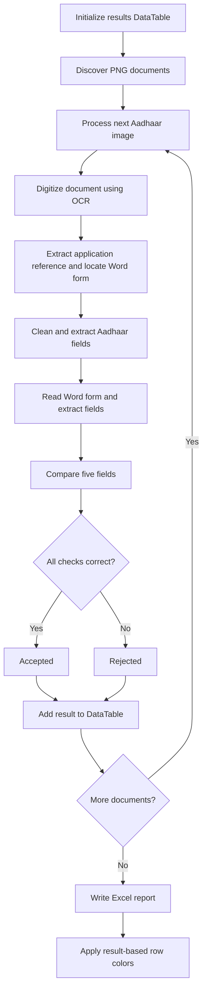

# Aadhaar Document Verification Bot

**UiPath · Robotic Process Automation (RPA) · Intelligent OCR · Regex · Microsoft Word · Excel**

## Overview

An RPA prototype built in UiPath Studio to automate the comparison of Aadhaar document information with application form data. The bot processes batches of scanned Aadhaar images, reads corresponding Microsoft Word forms, extracts key fields, and produces a color-coded Excel verification report.

The project demonstrates document processing, rule-based validation, Office automation, and exception handling within an end-to-end UiPath workflow.

## Features

- Batch processing of Aadhaar images (`.png`).
- Application-reference-based pairing with Word forms (`.docx`).
- Text extraction using the Digitize Document activity and UiPath Document OCR.
- Regex-based field extraction and text cleanup.
- Individual checks for name, Aadhaar number, date of birth, gender, and address.
- Consolidation of results using a DataTable.
- Excel report generation with green and red highlighting for accepted and rejected records.
- File-existence checks, Try Catch activities, and error logging.

## Workflow



The diagram represents the main successful-processing path. Per-document exceptions are logged; failed documents may not appear in the report in this version.

## Technology stack

| Technology | Purpose |
|---|---|
| UiPath Studio | Workflow development and execution |
| UiPath Intelligent OCR / Document OCR | Extract text from scanned documents |
| Document Understanding activities | Document digitization |
| VB.NET expressions and .NET Regex | Text processing and comparison |
| UiPath Word Activities | Read application forms |
| DataTables | Store verification records |
| UiPath Excel Activities | Output and format reports |
| UiPath System Activities | Control flow, exception handling, and logging |

## Repository structure

```text
Doc-Verification-Bot/
├── Main.xaml             # Main automation workflow
├── Main(Autosaved).xaml  # Autosaved workflow, not the entry point
├── project.json          # Project metadata and dependencies
├── entry-points.json     # Entrypoint metadata
├── project.uiproj        # UiPath project file
└── README.md             # Project documentation
```

## Getting started

### Prerequisites

- Windows and UiPath Studio (Windows-compatible project).
- Microsoft Word desktop, for the Word Application Scope activity.
- Access to UiPath Document OCR and a valid OCR credential configured securely.
- The activity packages declared in `project.json`, restored through Studio.

### Setup and execution

1. Clone the repository:

   ```bash
   git clone https://github.com/Cs7797/Doc-Verification-Bot.git
   ```

2. Open `project.json` in UiPath Studio and restore dependencies.
3. Before running, remove embedded OCR credentials, configure a replacement securely, and disable logs that expose document text. Use synthetic documents only.
4. Create the directories below or update the corresponding paths inside `Main.xaml`:

   ```text
   C:\UiPathProjects\
   ├── AadharInput\
   │   └── DEMO01_aadhaar.png
   ├── FormInput\
   │   └── DEMO01_form.docx
   └── Output\
   ```

5. Prepare a synthetic PNG and a corresponding Word form using the expected form template and field labels. The sample file names above are illustrative; input fixtures are not included in the repository. Use unique application references because the current form lookup uses a filename prefix.
6. Open `Main.xaml` and select **Run** in Studio. Acknowledge rejection dialogs if prompted.
7. Inspect `C:\UiPathProjects\Output\Result.xlsx`, on the `VerificationResults` worksheet.

## Verification report

The workflow writes the application reference, extracted identifier, form name, five field-level checks and overall result to Excel. Accepted records are highlighted green; rejected records are highlighted red.

Illustrative result (not an actual run; identifier masked for documentation):

| Application | Aadhaar | Name | DOB | Gender | Address | Result |
|---|---|---|---|---|---|---|
| DEMO01 | Correct | Correct | Correct | Correct | Correct | Accepted |
| DEMO02 | Correct | Incorrect | Correct | Correct | Correct | Rejected |

## Current limitations

- Extraction patterns depend on the supported document and Word form layouts; unfamiliar or noisy inputs may yield incorrect results.
- Prefix-based file matching may select an unintended form if application references overlap.
- Errors are logged, but some failed inputs may be absent from the final report.
- The workflow contains interactive dialogs and uses fixed paths; it is not a production-ready unattended deployment.
- This project demonstrates field consistency checks only. It does not authenticate documents, query UIDAI, or establish identity.

## Future improvements

- More robust field normalization, strict document pairing and review outcomes.
- Reusable workflows, configuration files, retries and comprehensive test coverage.
- Masked reporting, sanitized logs and secure external credential storage.
- Orchestrator integration and unattended execution readiness.


## Project purpose

Developed as a learning and portfolio project to demonstrate practical UiPath RPA development and document-processing automation.
